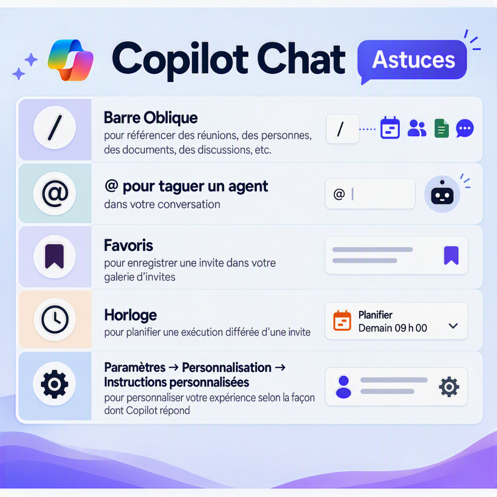

<!-- markdownlint-disable MD013 MD033 MD041 -->

## Bienvenue à l’expérience immersive Copilot pour les dirigeants du secteur bancaire {#welcome-to-the-copilot-immersion-experience-for-banking-leaders}

Une expérience ciblée de 90 minutes, axée sur des tâches concrètes de gestion pour les dirigeants des services bancaires aux entreprises.

Cette expérience propose des ressources simples et adaptables pour vous aider à passer du contexte d’affaires à l’action avec Microsoft 365 Copilot. Vous préparerez une rencontre de direction, examinerez les tendances d’un classeur de prévisions et transformerez vos constats en une mise à jour concise destinée à la haute direction.

🛡️

**Gardez l’expérience bien encadrée.** Utilisez uniquement les fonctionnalités activées dans votre environnement et du contenu approuvé. Examinez les sources citées et validez les faits et les calculs importants avant de partager un résultat.

## Ressources de l’expérience {#immersion-materials}

Commencez par les principes de rédaction des requêtes (prompts), réalisez l’atelier, gardez la bibliothèque de requêtes à portée de main et utilisez le guide de formation pour préparer la démonstration facultative de l’agent.

  <a class="lab-card" href="./commercial-bank-lab/">
    
      Parcours participant
    
    🏦
    Atelier — Services bancaires aux entreprises
    Préparez une rencontre de direction, analysez un classeur de prévisions et rédigez une mise à jour destinée à la haute direction.
    Commencer l’atelier →
  </a>
  <a class="lab-card" href="./executive-prompt-library/">
    
      Aide-mémoire
    
    💬
    Bibliothèque de requêtes pour la direction
    Des requêtes prêtes à copier pour les réunions, les revues de portefeuille et de risques, les communications et l’analyse dans Excel.
    Explorer les requêtes →
  </a>
  <a class="lab-card" href="./chief-of-staff-agent/">
    
      Préparation de la formation
    
    🧭
    Agent Chef de cabinet
    Créez et validez un agent simple, fondé sur un rôle, pour démontrer un scénario de travail ciblé de la direction.
    Consulter le guide →
  </a>
  <a class="lab-card" href="./prompting-best-practices/">
    
      Compétence essentielle
    
    ✨
    Trucs &amp; Astuces
    Rédigez des requêtes plus efficaces en précisant l’objectif, le contexte, les sources et les attentes.
    Découvrir la méthode →
  </a>

### Exemple de classeur Excel {#sample-workbook}

L’activité Excel utilise l’exemple de classeur Excel à [aka.ms/sampleExcel2](https://aka.ms/sampleExcel2). Téléchargez-le, enregistrez-le ou téléversez-le dans OneDrive, puis ouvrez la copie OneDrive avant d’utiliser Copilot dans Excel.

Le classeur fourni est en anglais. Conservez ses noms de feuilles et ses en-têtes de colonnes lorsque vous y faites référence; vous pouvez demander à Copilot de présenter son analyse en français canadien.

## Astuces pour Copilot Chat {#copilot-chat-top-tips}

Ces rappels pratiques vous aideront à obtenir des réponses plus claires et plus utiles dans Microsoft 365 Copilot Chat.

Copilot Chat propose des raccourcis et des commandes pour faire référence au contenu de votre organisation, faire appel à des agents, enregistrer et réutiliser des requêtes, planifier des requêtes et personnaliser les réponses.

| Raccourci ou commande | Utilisation |
| --- | --- |
| **Barre oblique `/`** | Faites référence à des réunions, des personnes, des documents ou des conversations. |
| **Arobase `@`** | Mentionnez un agent dans votre conversation. |
| **Icône de signet** | Enregistrez une requête dans votre galerie de requêtes pour la réutiliser. |
| **Icône d’horloge** | Planifiez l’exécution d’une requête. |
| **Paramètres → Personnalisation → Instructions personnalisées** | Adaptez la façon dont Copilot vous répond. |

Les libellés et les fonctionnalités disponibles peuvent varier selon la langue de votre interface, votre licence et les paramètres de votre organisation.

<!-- markdownlint-enable MD013 MD033 MD041 -->
