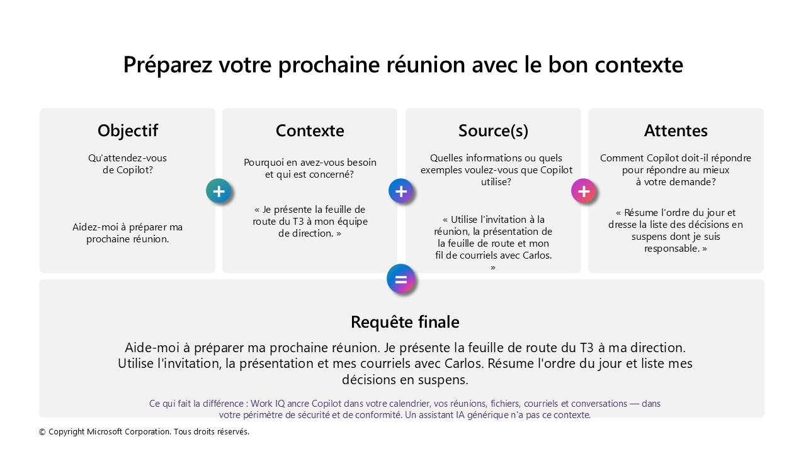

<!-- markdownlint-disable MD013 -->

# ✨ Trucs & Astuces

**Dites à Copilot Chat ce dont vous avez besoin.** Les requêtes (prompts) vous permettent de demander à Copilot de créer du contenu, de résumer de l’information, de réviser un texte, de faire des recherches ou de vous aider à accomplir une tâche.

Voyez vos échanges avec Copilot comme une conversation. Utilisez un langage clair et naturel, et fournissez le contexte que vous donneriez à une personne de confiance qui vous assiste dans votre travail.

## Ce que vous apprendrez {#what-youll-learn}

À la fin de ce guide, vous serez en mesure de :

- Reconnaître les quatre composantes d’une requête efficace
- Appuyer les réponses de Copilot sur les bonnes sources d’information de votre organisation
- Définir clairement vos attentes à l’égard de la réponse
- Transformer une demande simple en une requête utile qui vous aide à passer à l’action

::: info À noter
Vous n’avez pas besoin d’une syntaxe particulière ni d’un langage technique. Commencez par une demande claire, ajoutez le contexte et les sources pertinentes, puis décrivez la réponse souhaitée.
:::

## Préparez votre prochaine réunion {#prepare-for-your-next-meeting}

Une demande de base devient beaucoup plus utile lorsque vous précisez le résultat souhaité, le contexte d’affaires, les sources à consulter et le format de réponse attendu.

L’exemple ci-dessous illustre comment préparer une requête pour une réunion en utilisant les quatre composantes. Il montre également comment Work IQ peut aider Copilot à s’appuyer sur l’information liée à votre travail, notamment votre calendrier, vos réunions, vos fichiers, vos courriels et vos conversations.



Voici un autre exemple, prêt à copier, qui reprend les quatre composantes :

```text
Objectif : Aidez-moi à préparer ma prochaine réunion de suivi avec le client.

Contexte : Je veux faire le point sur les engagements pris et les décisions à prendre.

Sources : Utilisez l’invitation à la réunion, le compte rendu de la dernière
rencontre et les courriels récents liés à ce dossier auxquels j’ai accès.

Attentes : Répondez en français canadien, dans un ton professionnel.
Présentez un résumé concis, les points à discuter et les questions à poser.
Indiquez les sources utilisées et signalez toute information à confirmer.
```

::: tip Conseil
Avant votre prochaine réunion, indiquez au moins une source précise dans votre requête. Vous aiderez ainsi Copilot à produire une réponse à jour, pertinente et plus facile à vérifier.
:::

## Que pouvez-vous demander à Copilot? {#what-copilot-can-do}

Copilot peut vous aider à accomplir de nombreuses tâches courantes au travail.

### Réviser un texte {#review-text}

```text
Vérifiez si cet argumentaire de lancement de produit contient des incohérences.
Répondez en français canadien.
```

### Résumer de l’information {#summarize-information}

```text
Rédigez un résumé de séance en français canadien à partir de cette présentation.
```

### Créer du contenu convaincant {#create-engaging-content}

```text
Rédigez une proposition de valeur en français canadien pour notre nouveau
produit à partir de [Renseignements sur le produit].
```

### Faire des recherches sur un sujet {#research-a-topic}

```text
Présentez les dernières nouvelles du secteur concernant l’IA générative.
Répondez en français canadien.
```

::: tip Conseil
Adoptez un ton naturel, soyez précis et ne cherchez pas à formuler une première requête parfaite. Vous pouvez améliorer la réponse en posant des questions de suivi.
:::

## Les quatre composantes d’une requête efficace {#prompt-ingredients}

Pour obtenir une réponse plus pertinente et utile, précisez les quatre composantes suivantes :

| Composante | Question à vous poser |
| --- | --- |
| **Objectif** | Quelle réponse ou quel résultat souhaitez-vous obtenir de Copilot? |
| **Contexte** | Pourquoi en avez-vous besoin et qui est concerné? |
| **Sources** | Quels fichiers, réunions, messages, liens ou exemples Copilot doit-il utiliser? |
| **Attentes** | Comment Copilot doit-il structurer et présenter sa réponse? |

### 1. Objectif {#_1-goal}

Indiquez ce que vous voulez que Copilot fasse. Placez l’objectif au début de votre requête ou près du début.

```text
Aidez-moi à rédiger un courriel pour informer un client d’un changement
apporté à un produit.
```

### 2. Contexte {#_2-context}

Expliquez pourquoi vous avez besoin de cette réponse, qui est concerné et quelles circonstances sont importantes.

```text
Le client n’occupe pas le rôle d’administrateur général. Je dois donc
expliquer le changement dans des termes adaptés à son rôle.
```

### 3. Sources {#_3-source-s}

Précisez l’information que Copilot doit utiliser. Nommer des sources précises est l’un des moyens les plus efficaces d’améliorer le résultat.

```text
Utilisez l’annonce du changement publiée à [URL de l’annonce].
```

Les sources peuvent comprendre :

- Un document, une présentation ou un classeur
- Une invitation à une réunion ou une transcription
- Un fil de courriels ou une conversation Teams
- Une page Web ou une autre référence
- Un exemple du style ou du format souhaité

### 4. Attentes {#_4-expectations}

Décrivez les caractéristiques d’une bonne réponse. Précisez le format, la longueur, le ton, le public cible ou les sections souhaitées.

```text
Présentez l’information de façon claire et concise, en français canadien,
dans un ton professionnel.
```

::: warning Important
Il est facile d’oublier de préciser vos attentes. Sans ces indications, Copilot doit choisir lui-même la longueur, le niveau de détail, le ton et la structure de sa réponse.
:::

## Combinez les quatre composantes {#complete-prompt}

Réunissez les quatre composantes dans une seule requête, formulée de façon naturelle.

```text
Aidez-moi à rédiger un courriel pour informer un client d’un changement
apporté à un produit. Le client n’occupe pas le rôle d’administrateur
général. Je dois donc expliquer le changement dans des termes adaptés
à son rôle. Utilisez l’annonce du changement publiée à [URL de l’annonce].
Présentez l’information de façon claire et concise, en français canadien,
dans un ton professionnel.
```

Voici le rôle de chaque composante dans cette requête :

| Composante | Extrait de la requête |
| --- | --- |
| **Objectif** | Aidez-moi à rédiger un courriel pour informer un client d’un changement apporté à un produit. |
| **Contexte** | Le client n’occupe pas le rôle d’administrateur général. Je dois donc expliquer le changement dans des termes adaptés à son rôle. |
| **Sources** | Utilisez l’annonce du changement publiée à [URL de l’annonce]. |
| **Attentes** | Présentez l’information de façon claire et concise, en français canadien, dans un ton professionnel. |

## Un modèle de requête réutilisable {#reusable-prompt-pattern}

Utilisez cette structure comme point de départ :

```text
Objectif : [Que voulez-vous que Copilot fasse?]

Contexte : [Pourquoi en avez-vous besoin et qui est concerné?]

Sources : [Quels fichiers, réunions, messages, liens ou exemples Copilot doit-il utiliser?]

Attentes : [Quel format, quelle longueur, quel ton ou quel niveau de détail souhaitez-vous?]
Répondez en français canadien.
```

Vous pouvez aussi regrouper les mêmes composantes dans un paragraphe :

```text
[Objectif]. [Contexte]. Utilisez [sources]. Respectez [attentes].
Répondez en français canadien.
```

## Comment évaluer la qualité de la réponse {#what-good-looks-like}

Avant d’utiliser la réponse, vérifiez les éléments suivants :

- L’objectif est-il clair?
- Avez-vous fourni suffisamment de contexte?
- Avez-vous indiqué les sources les plus pertinentes?
- Avez-vous décrit le format et le niveau de détail attendus?
- Les faits importants sont-ils appuyés par des sources que vous pouvez vérifier?
- La réponse convient-elle au public cible?

## À retenir {#key-takeaway}

Une requête efficace combine :

```text
Objectif + Contexte + Sources + Attentes
```

Commencez par le résultat souhaité, appuyez la requête sur les bonnes sources d’information de votre organisation et décrivez les caractéristiques d’une réponse utile. Examinez ensuite le résultat, vérifiez les faits importants et affinez votre requête au fil de la conversation.

<!-- markdownlint-enable MD013 -->
